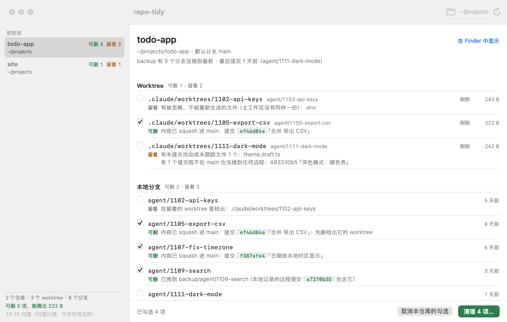

# repo-tidy

[中文](README.md) | English

**One command scans every git repository under a folder and tells you which worktrees and local branches left behind by AI coding agents can provably be deleted — with evidence for each one. Read-only by default.**

Agents like Claude Code and Codex open a worktree and a branch for every task. A few weeks later a single repository has dozens of worktrees, and you can no longer tell which were merged, which still hold uncommitted work, and which contain the only copy of a `.env`. `git branch --merged` misses squash and rebase merges, and checking each one by hand is slow.

repo-tidy sorts every worktree and local branch into two groups:

- **Removable**, with evidence: the commit on the default branch that already contains the work, or the remote ref it was pushed to;
- **Keep**, with the reason: uncommitted changes, commits that are neither merged nor pushed, ignored files that can't be regenerated (`.env`), a lock, a rebase in progress…



> The CLI and the app currently speak Chinese only. English output is planned; the screenshots and sample output below are in Chinese.

## Why you can let it delete things

**It only removes what it can prove.** A branch counts as "already in the default branch" only if one of these holds: its tip is an ancestor of the default branch; the patch-id of its whole diff matches a commit on the default branch (squash); every commit has a counterpart with the same patch-id (rebase); or a simulated `git merge-tree` merge produces exactly the default branch's tree. Otherwise it is removable only if a remote-tracking ref contains its tip. A worktree must also be clean: no uncommitted changes, no untracked files, no operation in progress, and every ignored file must be either regenerable (`node_modules`, `dist`, …) or identical to a copy in the main worktree.

**Every item comes with evidence.** Not just a list of names, but a sentence you can check yourself, such as "squashed into main in commit a835964c".

**It confirms before deleting.** Scanning is read-only: no fetch, no index refresh, nothing written into `.git`. Only `--apply` deletes, and it re-checks every item first; items removable because they were pushed are confirmed online with `git ls-remote`. Worktrees are removed with `git worktree remove` (no `--force`). Before each deletion the restore command is written to a log, so a mistake is one command away from being undone.

## Install

Requires git 2.38 or newer.

**Prebuilt binary** (macOS on Apple silicon; use `darwin_amd64` for Intel Macs, `linux_amd64` or `linux_arm64` for Linux):

```bash
curl -fsSL https://github.com/dodo258/repo-tidy/releases/latest/download/repo-tidy_darwin_arm64.tar.gz | tar -xz repo-tidy
sudo mv repo-tidy /usr/local/bin/
```

Each release ships a `SHA256SUMS` file for `shasum -a 256 -c`. If you download with a browser, macOS quarantines the file; run `xattr -d com.apple.quarantine repo-tidy` once.

**With Go** (1.26 or newer):

```bash
go install github.com/dodo258/repo-tidy/cmd/repo-tidy@latest
```

## Three ways to use it

**1. See how messy all your projects are** (read-only)

```bash
repo-tidy ~/projects
```

The report opens with a summary, then lists repositories from messiest to cleanest; clean ones take one line each. Each repository also gets a health check (report only): disk usage, uncommitted changes and stashes in the main worktree, ahead/behind its upstream, the last commit, and whether a remote named `backup` is up to date (`--online` checks it over the network).

**2. Clean up what agents left in one repository**

```bash
repo-tidy ~/projects/app            # look first
repo-tidy --apply ~/projects/app    # then delete
```

It prints where the restore log is (`~/.local/state/repo-tidy/apply-<time>.log`), containing commands like `git branch <name> <commit>` and `git worktree add …`.

**3. Feed scripts and agents**

```bash
repo-tidy --json ~/projects | jq .summary
```

To delete only some items, pipe items picked from `--json` straight into `--select` — for example only removable branches starting with `agent/`:

```bash
repo-tidy --json ~/projects \
  | jq '{items: [.repos[].branches[] | select(.verdict == "removable" and (.name | startswith("agent/")))]}' \
  | repo-tidy --apply --select -
```

Field reference, rules and exit codes: [docs/reference.md](docs/reference.md) (Chinese).

## Mac app

`mac/` contains a native SwiftUI app (macOS 14+). Repositories on the left, sorted by mess; the selected repository's worktrees and branches on the right, each with its verdict and evidence. Only removable items can be checked. "Clean up" first lists every item and its evidence again, and deletes only after you confirm. A menu bar icon shows the number of removable items.

The app is only a shell — all judging and deleting is done by the CLI, so install `repo-tidy` first. The app is not signed or notarized yet; build it from source (Xcode or a Swift 6 toolchain):

```bash
git clone https://github.com/dodo258/repo-tidy && cd repo-tidy
mac/scripts/build-app.sh
open mac/build/RepoTidy.app
```

## Compared with

| | Detects squash / rebase merges | Handles worktrees | Many repos at once | Evidence per item | Read-only by default |
|---|---|---|---|---|---|
| `git branch --merged` | no | no | no | no | yes |
| git-delete-squashed | squash | no | no | no | no, deletes directly |
| gh-poi | via GitHub PR state | yes | no | no | no |
| worktrunk | yes | yes, one at a time | no | — | — |
| **repo-tidy** | **yes, offline** | **yes, and protects `.env`** | **yes** | **yes** | **yes** |

What repo-tidy does not do: clean build artifacts and caches (use npkill, Mole and the like); delete remote branches; touch stashes; rewrite history; call the GitHub API.

## Limitations

- Output is Chinese only for now.
- The `backup` health check only looks at a remote named `backup`.
- Deleting a branch only removes the ref; objects are freed by `git gc`, so "space freed" counts only removable worktree directories.

## Development

```bash
go test ./...                                   # tests only create repositories in temp dirs
go build -o bin/repo-tidy ./cmd/repo-tidy
cd mac && swift build && REPO_TIDY_BIN=$PWD/../bin/repo-tidy swift test
```

## License

[MIT](LICENSE)
