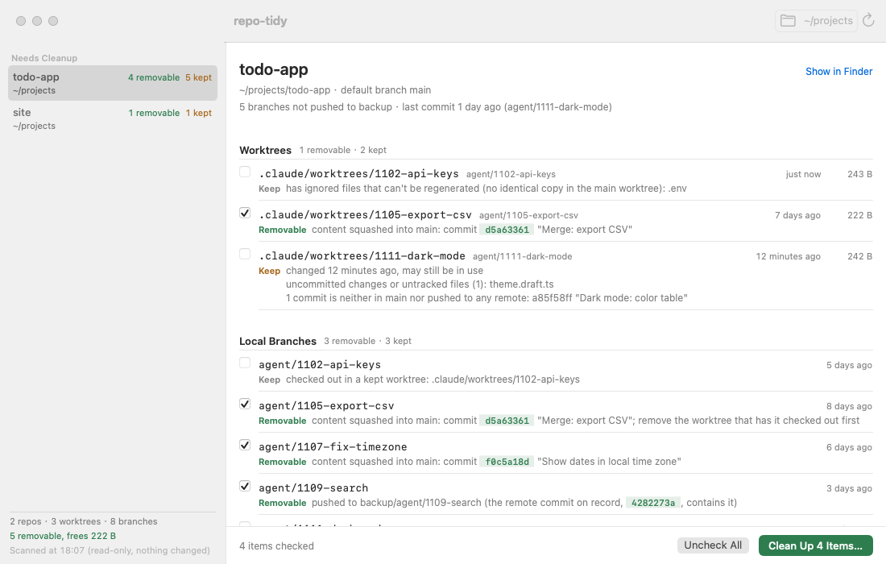
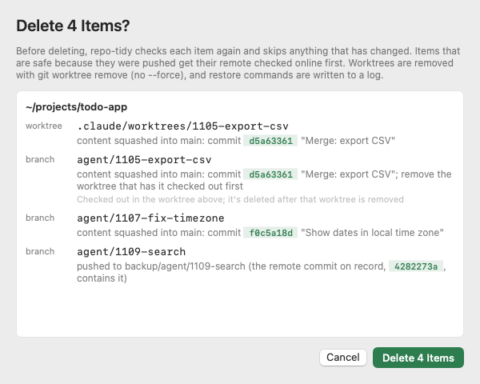
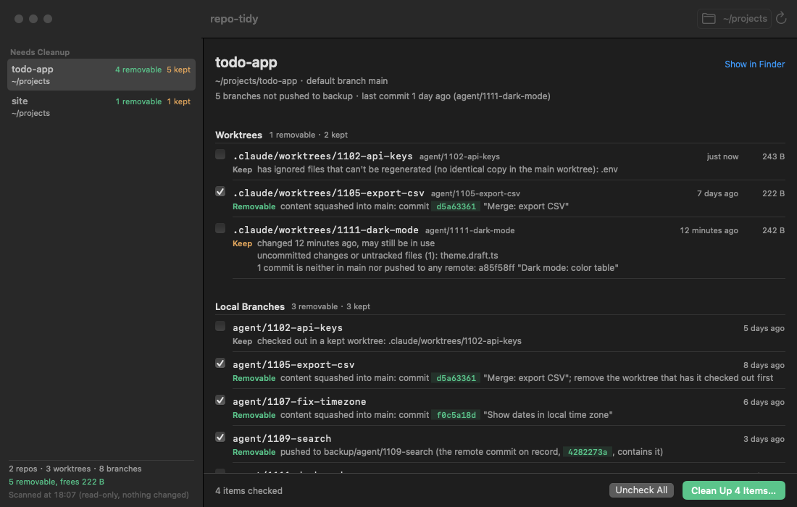

# repo-tidy

[中文](README.md) | English

**One command scans every git repository under a folder and tells you which worktrees and local branches left behind by AI coding agents can provably be deleted — with evidence for each one. Read-only by default.**

Agents like Claude Code and Codex open a worktree and a branch for every task. A few weeks later a single repository has dozens of worktrees, and you can no longer tell which were merged, which still hold uncommitted work, and which contain the only copy of a `.env`. `git branch --merged` misses squash and rebase merges, and checking each one by hand is slow.

repo-tidy sorts every worktree and local branch into two groups:

- **Removable**, with evidence: the commit on the default branch that already contains the work, or the remote ref it was pushed to;
- **Keep**, with the reason: uncommitted changes, commits that are neither merged nor pushed, ignored files that can't be regenerated (`.env`), a lock, a rebase in progress…



## Why you can let it delete things

**It only removes what it can prove.** A branch counts as "already in the default branch" only if one of these holds: its tip is an ancestor of the default branch; the patch-id of its whole diff matches a commit on the default branch (squash); every commit has a counterpart with the same patch-id (rebase); or a simulated `git merge-tree` merge produces exactly the default branch's tree. Otherwise it is removable only if a remote-tracking ref contains its tip. A worktree must also be clean: no uncommitted changes, no untracked files, no operation in progress, and every ignored file must be either regenerable (`node_modules`, `dist`, …) or identical to a copy in the main worktree.

**It leaves worktrees in use alone.** Between commits an agent's worktree is clean, and if its commits are pushed automatically, content alone would say it is removable. So a worktree is always kept if some process has its working directory inside it (a shell, `go test`, …; the report names the process and its pid), or if its index, HEAD or reflog changed in the last 30 minutes; the branch checked out there is kept too. Change the window with `--min-idle`, or turn the time rule off with `--min-idle 0`. If processes cannot be listed, every worktree is treated as possibly in use.

**Every item comes with evidence.** Not just a list of names, but a sentence you can check yourself, such as "squashed into main in commit a835964c".

**It confirms before deleting.** Scanning is read-only: no fetch, no index refresh, nothing written into `.git`. Only `--apply` deletes, and it re-checks every item first (including whether a process is using it now); items removable because they were pushed are confirmed online with `git ls-remote`. Worktrees are removed with `git worktree remove` (no `--force`). Before each deletion the restore command is written to a log, so a mistake is undone with one command: `repo-tidy --undo --apply`.

## Install

Requires git 2.38 or newer.

**Prebuilt binary** (macOS on Apple silicon; use `darwin_amd64` for Intel Macs, `linux_amd64` or `linux_arm64` for Linux):

```bash
curl -fsSL https://github.com/dodo258/repo-tidy/releases/latest/download/repo-tidy_darwin_arm64.tar.gz | tar -xz repo-tidy
sudo mv repo-tidy /usr/local/bin/
```

Each release ships a `SHA256SUMS` file for `shasum -a 256 -c`. If you download with a browser, macOS quarantines the file; run `xattr -d com.apple.quarantine repo-tidy` once.

**With Go** (1.26 or newer):

```bash
go install github.com/dodo258/repo-tidy/cmd/repo-tidy@latest
```

## Three ways to use it

**1. See how messy all your projects are** (read-only)

```bash
repo-tidy ~/projects
```

The report opens with a summary, then lists repositories from messiest to cleanest; clean ones take one line each:

```text
Overview  scanned 2 repos · extra worktrees: 3 · local branches: 8
          removable: 5 (worktrees 1, branches 4), frees 222 B
          keep: 6 (worktrees 2, branches 4), 4 with unmerged work

~/projects/todo-app  3 extra worktrees · 6 local branches · default branch main
  worktrees  removable 1 · keep 2
    remove  .claude/worktrees/1105-export-csv  [agent/1105-export-csv]  idle 7 days · 222 B  squashed into main fb31fca9
    keep    .claude/worktrees/1111-dark-mode  [agent/1111-dark-mode]  active today · 242 B
          changed 12 minutes ago, may still be in use
          uncommitted changes or untracked files (1): theme.draft.ts
          1 commit is neither in main nor pushed to any remote: 0651d899 "Dark mode: color table"
    keep    .claude/worktrees/1102-api-keys  [agent/1102-api-keys]  active today · 243 B
          has ignored files that can't be regenerated (no identical copy in the main worktree): .env
  local branches  removable 3 · keep 3
    remove  agent/1105-export-csv  idle 8 days  squashed into main fb31fca9; remove the worktree that has it checked out first
    remove  agent/1107-fix-timezone  idle 6 days  squashed into main bfd54c8e
    remove  agent/1109-search  idle 3 days  pushed to backup/agent/1109-search
    keep    wip/voice-input  idle 12 days
          1 commit is neither in main nor pushed to any remote: 7e4307be "Voice input: first try"
```

Each removable item takes one line ending in a short form of its evidence: the default-branch commit that contains it (`squashed into main fb31fca9`) or the remote ref it was pushed to (`pushed to backup/agent/1109-search`). A repository with more than 10 removable items first gets one line counting them by basis (`removable 23 items: merged 17, pushed 6`). Kept items still list every reason. `--verbose` puts the full evidence sentence on its own line under each removable item, such as `content squashed into main: commit fb31fca9 "Merge: export CSV"`.

A directory is searched one level down by default. If your code lives in `~/code/<org>/<repo>`, add `--depth 2` (at most 4) to look further down. Once a repository is found it is not searched further (its worktrees and submodules are not separate repositories); hidden directories, `node_modules` and symlinks are skipped.

When there are too many items, filter them: `--older-than 30d` (or `2w`) shows only items last active more than a month ago, and `--only branches` shows only local branches (`--only worktrees` only worktrees); the two can be combined. Filtered-out items aren't shown or counted in the overview, and `--apply` won't delete them; the overview ends with a "filtered" line naming the conditions. For example, to clean up only branches idle for a month: `repo-tidy --older-than 30d --only branches --apply ~/projects`.

Each repository also gets a health check (report only): disk usage, uncommitted changes and stashes in the main worktree, ahead/behind its upstream, the last commit, and whether a backup remote is up to date (`--online` checks it over the network). The backup remote is `backup` unless you pass `--backup-remote <name>`; repositories without it simply skip this line, unless you passed `--backup-remote` explicitly, in which case a missing remote is reported.

The language follows `LC_ALL`, `LC_MESSAGES` or `LANG`: Chinese when it starts with `zh`, English otherwise. `--lang en` or `--lang zh` picks one explicitly. The Mac app follows the system language.

**2. Clean up what agents left in one repository**

```bash
repo-tidy ~/projects/app            # look first
repo-tidy --apply ~/projects/app    # then delete
```

It prints where the restore log is (`~/.local/state/repo-tidy/apply-<time>.log`), containing commands like `git branch <name> <commit>` and `git worktree add …`. Deleted the wrong thing?

```bash
repo-tidy --undo            # list what the last cleanup deleted and can be restored
repo-tidy --undo --apply    # recreate it: branches at their original commits, worktrees at their original paths
```

`--undo <log>` picks which cleanup to undo. Branches and directories that already exist are skipped; commits already removed by `git gc` are reported.

**3. Feed scripts and agents**

```bash
repo-tidy --json ~/projects | jq .summary
```

To delete only some items, pipe items picked from `--json` straight into `--select` — for example only removable branches starting with `agent/`:

```bash
repo-tidy --json ~/projects \
  | jq '{items: [.repos[].branches[] | select(.verdict == "removable" and (.name | startswith("agent/")))]}' \
  | repo-tidy --apply --select -
```

Field reference, rules and exit codes: [docs/reference.md](docs/reference.md) (Chinese).

## Mac app

`mac/` contains a native SwiftUI app (macOS 14+). Repositories on the left, sorted by mess; the selected repository's worktrees and branches on the right, each with its verdict and evidence. Only removable items can be checked. "Clean up" first lists every item and its evidence again, and deletes only after you confirm; the results sheet has "Undo This Cleanup", which runs the same `repo-tidy --undo`. A menu bar icon shows the number of removable items.

<p>
  
  
</p>

No separate CLI install needed: the build puts a `repo-tidy` compiled from the same source (universal, Apple silicon and Intel) into `RepoTidy.app/Contents/Helpers/`, and the app does all judging and deleting through it — the UI has no logic of its own. To use your own build instead, set its path in Settings or set `REPO_TIDY_BIN`. "Search depth" in Settings is the same as `--depth`.

The app is not signed or notarized yet; build it from source (Go 1.26 plus Xcode or a Swift 6 toolchain):

```bash
git clone https://github.com/dodo258/repo-tidy && cd repo-tidy
mac/scripts/build-app.sh
open mac/build/RepoTidy.app
```

## Compared with

| | Detects squash / rebase merges | Handles worktrees | Many repos at once | Evidence per item | Read-only by default |
|---|---|---|---|---|---|
| `git branch --merged` | no | no | no | no | yes |
| git-delete-squashed | squash | no | no | no | no, deletes directly |
| gh-poi | via GitHub PR state | yes | no | no | no |
| worktrunk | yes | yes, one at a time | no | — | — |
| **repo-tidy** | **yes, offline** | **yes, and protects `.env`** | **yes** | **yes** | **yes** |

What repo-tidy does not do: clean build artifacts and caches (use npkill, Mole and the like); delete remote branches; touch stashes; rewrite history; call the GitHub API.

## Limitations

- The Mac app is not signed or notarized yet, so it has to be built from source.
- Deleting a branch only removes the ref; objects are freed by `git gc`, so "space freed" counts only removable worktree directories.

## Development

```bash
go test ./...                                   # tests only create repositories in temp dirs
go build -o bin/repo-tidy ./cmd/repo-tidy
mac/scripts/test-app.sh                         # build the app, scan demo repos with only its bundled CLI
cd mac && swift build && REPO_TIDY_BIN=$PWD/../bin/repo-tidy swift test
```

## License

[MIT](LICENSE)
