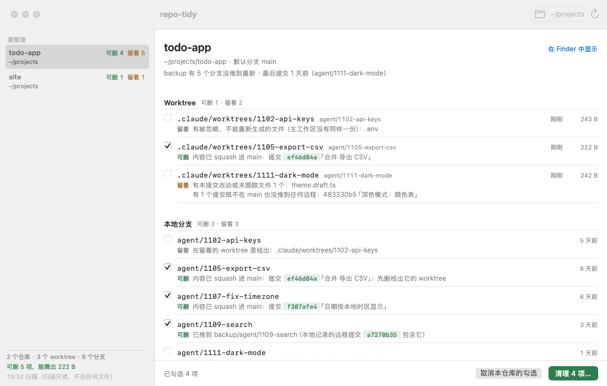
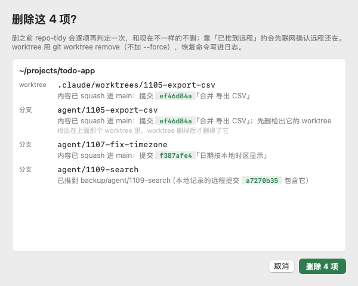
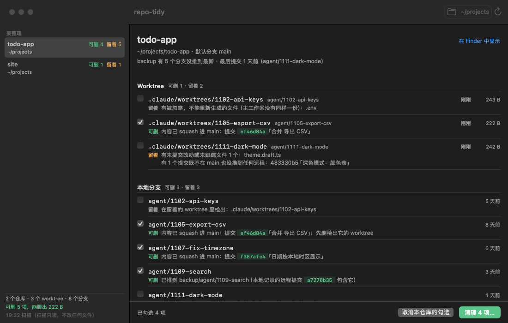

# repo-tidy

中文 | [English](README.en.md)

**一条命令扫完一个目录下所有 git 仓库，找出 AI 代理留下的 worktree 和本地分支里哪些能证明可以删，每一项都给证据；默认只看不删。**

Claude Code、Codex 这类代理每做一件事就开一个 worktree、一个分支。几周下来，一个仓库里几十个 worktree，哪个合并过、哪个还有没提交的改动、哪个里面放着唯一一份 `.env`，已经分不清了。`git branch --merged` 认不出 squash 和 rebase 合并的分支，手动一个个查又太慢。

repo-tidy 把每个 worktree 和本地分支分成两类：

- **可删**：附证据——内容在默认分支的哪个提交里，或推到了哪个远程的哪个引用；
- **留着**：写明原因——未提交改动、没合并也没推送的提交、被忽略但不能重新生成的文件（`.env`）、锁定、做到一半的 rebase……



## 为什么敢让它删

**只删能证明的。** 分支内容算「已在默认分支」，要命中下面一条：末端是默认分支的祖先；整段改动的 patch-id 等于默认分支上某个提交（squash）；每个提交都有同 patch-id 的对应提交（rebase）；用 `git merge-tree` 模拟合并，结果和默认分支一模一样。都不满足时，只有远程跟踪引用包含它的末端才算「已推到远程」。worktree 还要干净：没有未提交改动、没有未跟踪文件、没有做到一半的操作，被忽略的文件要么能重新生成（`node_modules`、`dist` 这类），要么主工作区有一模一样的一份。

**每项给证据。** 不是一个名字列表，而是「内容已 squash 进 main：提交 a835964c「合并 导出 CSV」」这样一句能自己去核对的话。

**删前确认。** 默认只读：扫描时不 fetch、不刷新 index、不往 `.git` 里写东西。加 `--apply` 才删，而且删之前每一项重新判定一遍，靠「已推到远程」的先联网 `git ls-remote` 确认远程现在还有；worktree 用 `git worktree remove`（不加 `--force`）。每删一项先把恢复命令写进日志，删错了照着跑一遍就回来。

## 安装

需要 git 2.38 以上。

**下载编好的二进制**（macOS Apple 芯片；Intel Mac 换成 `darwin_amd64`，Linux 换成 `linux_amd64` 或 `linux_arm64`）：

```bash
curl -fsSL https://github.com/dodo258/repo-tidy/releases/latest/download/repo-tidy_darwin_arm64.tar.gz | tar -xz repo-tidy
sudo mv repo-tidy /usr/local/bin/
```

每个版本附 `SHA256SUMS`，可以用 `shasum -a 256 -c` 核对。用浏览器下载的话，macOS 会给文件加隔离标记，跑一次 `xattr -d com.apple.quarantine repo-tidy` 再用。

**用 Go 装**（Go 1.26 以上）：

```bash
go install github.com/dodo258/repo-tidy/cmd/repo-tidy@latest
```

## 三个用法

**1. 看一眼所有项目乱不乱**（只读，什么都不删）

```bash
repo-tidy ~/projects
```

开头是总览，下面的仓库按乱的程度排，干净的每个只占一行：

```text
总览  扫了 2 个仓库 · 附加 worktree 3 个 · 本地分支 8 个
      可删 5 项（worktree 1、分支 4），能腾出 258 B
      留着 6 项（worktree 2、分支 4），其中 4 项有未合并内容

~/projects/todo-app  3 个附加 worktree · 6 个本地分支 · 默认分支 main
  worktree  可删 1 · 留着 2
    可删  .claude/worktrees/1105-export-csv  [agent/1105-export-csv]  今天动过 · 258 B
          内容已 squash 进 main：提交 a835964c「合并 导出 CSV」
    留着  .claude/worktrees/1111-dark-mode  [agent/1111-dark-mode]  今天动过 · 278 B
          有未提交改动或未跟踪文件 1 个：theme.draft.ts
          有 1 个提交既不在 main 也没推到任何远程：2f9aa3e1「深色模式：颜色表」
    留着  .claude/worktrees/1102-api-keys  [agent/1102-api-keys]  今天动过 · 279 B
          有被忽略、不能重新生成的文件（主工作区没有同样一份）：.env
  本地分支  可删 3 · 留着 3
    可删  agent/1107-fix-timezone  6 天没动
          内容已 squash 进 main：提交 d7259337「日期按本地时区显示」
    可删  agent/1109-search  3 天没动
          已推到 backup/agent/1109-search（本地记录的远程提交 7aab07ec 包含它）
    留着  wip/voice-input  12 天没动
          有 1 个提交既不在 main 也没推到任何远程：f90c4e69「语音输入：试一下」
```

每个仓库还有一段体检（只报不动）：占用空间、主工作区未提交改动和 stash、当前分支相对上游领先落后、最后一次提交，以及名为 `backup` 的远程是不是推到了最新（加 `--online` 联网查）。

**2. 清掉一个仓库里代理留下的东西**

```bash
repo-tidy ~/projects/app            # 先看
repo-tidy --apply ~/projects/app    # 确认没问题再删
```

删完会告诉你恢复日志在哪（`~/.local/state/repo-tidy/apply-<时间>.log`），里面是 `git branch <名字> <提交>`、`git worktree add …` 这样的命令。

**3. 给脚本和代理用**

```bash
repo-tidy --json ~/projects | jq .summary
```

想只删一部分，把 `--json` 里挑出来的项原样喂给 `--select`，比如只删 `agent/` 开头的可删分支：

```bash
repo-tidy --json ~/projects \
  | jq '{items: [.repos[].branches[] | select(.verdict == "removable" and (.name | startswith("agent/")))]}' \
  | repo-tidy --apply --select -
```

字段说明、判定细节、退出码见 [docs/reference.md](docs/reference.md)。

## Mac App

不想敲命令，可以用 `mac/` 里的原生界面（SwiftUI，macOS 14 以上）：左边是全部仓库，按乱的程度排；右边是选中仓库的每个 worktree 和分支，带结论和证据。只有「可删」的能勾，点「清理」先弹窗把要删的每一项和证据再列一遍，确认才删。菜单栏图标显示可删项总数。

<p>
  
  
</p>

App 只是外壳，判定和删除全由命令行做，所以要先装好上面的 `repo-tidy`。App 暂时没有签名和公证，从源码编（需要 Xcode 或 Swift 6 工具链）：

```bash
git clone https://github.com/dodo258/repo-tidy && cd repo-tidy
mac/scripts/build-app.sh
open mac/build/RepoTidy.app
```

## 和同类比

| | 认 squash / rebase 合并 | 管 worktree | 一次扫多个仓库 | 每项给证据 | 默认只读 |
|---|---|---|---|---|---|
| `git branch --merged` | 否 | 否 | 否 | 否 | 是 |
| git-delete-squashed | squash | 否 | 否 | 否 | 否，直接删 |
| gh-poi | 靠 GitHub PR 状态 | 是 | 否 | 否 | 否 |
| worktrunk | 是 | 是，逐个删 | 否 | — | — |
| **repo-tidy** | **是，离线判定** | **是，还保护 `.env`** | **是** | **是** | **是** |

repo-tidy 不做的事：不清构建产物和缓存（用 npkill、Mole 这类工具）；不删远程分支；不碰 stash；不改提交历史；不调 GitHub API。

## 现在的限制

- 输出只有中文，英文输出在计划里。
- 体检里的 backup 一项只看名叫 `backup` 的远程。
- 删分支只删引用，提交对象要等 `git gc` 才真正释放，所以「能腾出的空间」只算可删 worktree 的目录大小。

## 开发

```bash
go test ./...                                   # 测试只在临时目录造仓库
go build -o bin/repo-tidy ./cmd/repo-tidy
cd mac && swift build && REPO_TIDY_BIN=$PWD/../bin/repo-tidy swift test
```

## 许可证

[MIT](LICENSE)
